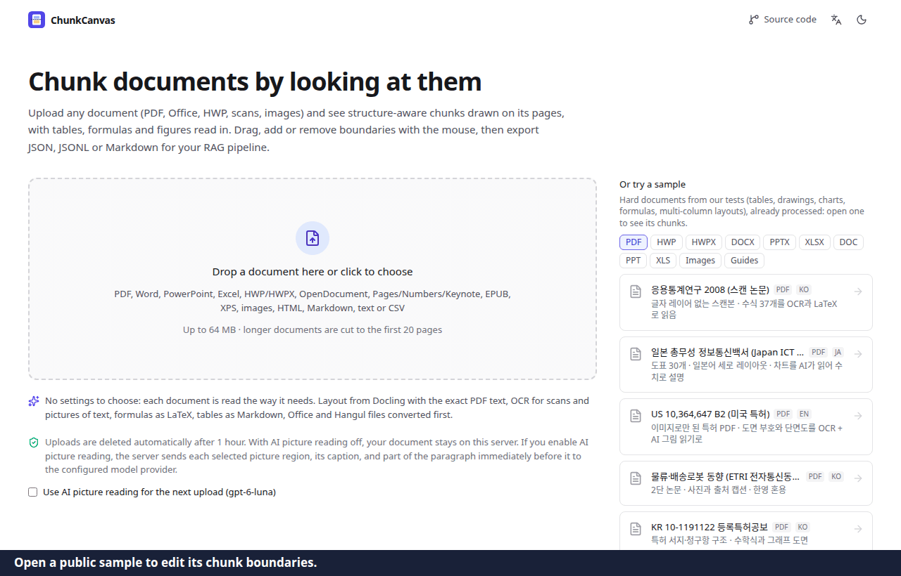
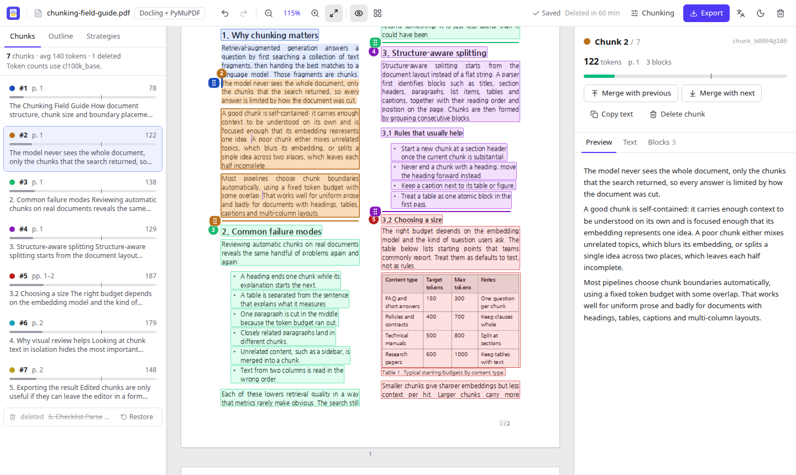
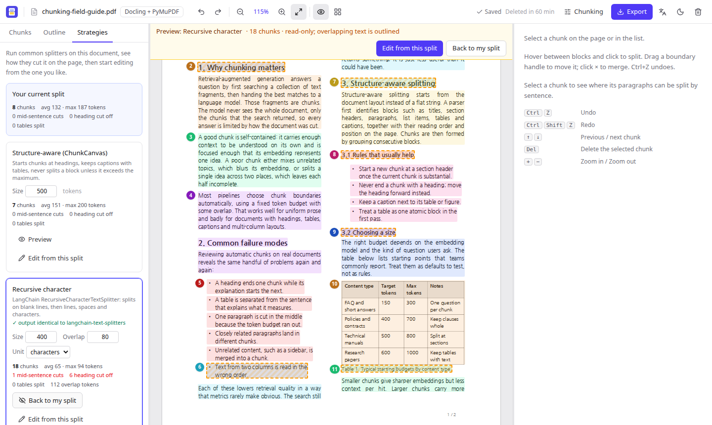

# ChunkCanvas

**See and edit RAG chunk boundaries directly on the original document.**

ChunkCanvas parses a document (PDF, Word, PowerPoint, Excel, HWP/HWPX, OpenDocument, Pages/Numbers/
Keynote, EPUB, XPS, scans and images, HTML, Markdown, text or CSV) into layout blocks, splits it into structure-aware chunks, and draws those chunks on
top of the rendered pages. You fix the split with the mouse (drag a boundary,
click between blocks to split, click × to merge, delete a chunk you do not want) and export the
result as JSONL, JSON or Markdown for your RAG pipeline.

- **[Open the public demo](https://chunkcanvas.coco-ai.shop)** to edit and export without signing up.
  Longer PDFs are limited to their first 20 pages. Uploads expire after one hour.
  Optional AI picture reading requires a password that is not published. On your own
  installation, set your provider key and choose your own password. See [Pictures](#pictures).
- **License:** MIT (see [Licenses](#licenses) for dependencies)



<details>
<summary>Editor and splitter comparison screenshots</summary>





</details>

## Features

- **Edit on the page.** Chunks are drawn per block region, never as full-width bands, so
  multi-column layouts and paragraphs that continue onto the next page or column stay correct.
- **Split inside paragraphs.** With character positions from the PDF text layer, a chunk can end
  mid-paragraph. Select a chunk to see its sentence boundaries; click one to split there, or drag
  any boundary and it snaps to sentences and block gaps.
- **Compare common splitters.** Run LangChain's RecursiveCharacter, Character and Token splitters
  (output identical to `langchain-text-splitters`, verified in tests), sentence packing, Markdown
  headers and ChunkCanvas's structure-aware split on the same document. Each shows how many cuts
  land mid-sentence, how many headings are cut off from their text and how many tables are split;
  preview any of them on the page (overlap hatched) and start editing from it.
- **Structure-aware first pass.** Starts chunks at headings, keeps headings with their text (a
  heading never ends a chunk on its own) and captions with their tables, and splits an oversized
  paragraph at sentence ends — a single sentence longer than the maximum (a patent claim) after
  its commas. An oversized table is cut between rows, and every piece repeats the header row;
  you can cut a table yourself only between rows. Notes at the foot of the pages (footnotes,
  author and funding notes) are read after all the text, in chunks of their own, so they never
  split a passage that runs on over the page; running heads and feet, page numbers and the
  logos repeated on every page or slide are left out.
- **Delete chunks.** Select a chunk and press Delete (or "Delete chunk") to leave it out of every
  export: a cover page, a table of contents, a disclaimer. It stays on the page, hatched, until you
  restore it; the remaining chunks are numbered as they are exported, and undo brings it back.
- **Instant feedback.** Chunks are recomputed in the browser on every edit; text, Markdown
  preview and token counts update immediately. Choose `cl100k_base` or `o200k_base` (fewer tokens
  for Korean and CJK). Undo/redo, autosave.
- **Any common document.** Non-PDF uploads are converted to pages first and then go through the
  same parser and editor: Office, OpenDocument and iWork formats with LibreOffice, HWPX from its
  XML, HWP from its records, XPS with MuPDF, EPUB/HTML/Markdown/text/CSV as clean HTML, images
  through OCR. Pictures inside digital documents are OCR'd too. Formats are recognized by
  content, not by file name.
- **Hybrid parsing.** Docling decides the layout (headings, lists, tables, reading order); PyMuPDF
  supplies the exact text layer and character positions, restores word spaces and
  code line breaks that Docling drops, and recovers any text Docling missed. Pages Docling cannot
  read fall back to PyMuPDF's structure, and PDFs without a text layer (scans, image-only decks)
  go to CPU OCR automatically. Everything runs on CPU; no GPU or cloud API is needed.
- **Reproducible output.** Exports carry block ids, character ranges, page ranges and source
  coordinates; overlap is applied at export time. The split plan exports separately and can be
  re-applied to the same parse.
- **Public hosting controls.** Upload size and page limits, per-client rate limits, a bounded job
  queue, per-document access tokens, automatic deletion, and (on Linux) parsing inside a
  bubblewrap sandbox with networking disabled.

## Install on Ubuntu

The public demo runs on Ubuntu 24.04 x86-64 with Python 3.12, Node.js 24 for the web
build, and the vendor build of LibreOffice 26.2.7.3 for conversion. The systemd user
service requires working unprivileged user namespaces and bubblewrap, including support
for nested parser sandboxes. A fresh OS install, other platforms and the distribution's
LibreOffice packages were not tested for this guide.

1. On Ubuntu 24.04 x86-64, install the host packages below and clone the repository.
   Have Node.js 24 and npm on your path.

   ```bash
   sudo apt install git curl python3-venv bubblewrap fonts-nanum fonts-noto-cjk \
       libxinerama1 libcups2t64 libnss3 libcairo2 libx11-xcb1
   git clone https://github.com/bumjopark/chunkcanvas
   cd chunkcanvas
   ```

   The five libraries on the second line are needed even for headless conversion.
   We identified the required libraries by running the vendor converter with individual
   libraries hidden, then checked which Ubuntu 24.04 packages pull them in.

2. From the repository root, [unpack and verify LibreOffice](docs/deployment.md#updating-a-privately-unpacked-libreoffice).
   This provides the converter for Office and Hangul files. Then prepare the parser
   environment, download its models and build the web app.

   ```bash
   python3 -m venv services/api/.venv
   services/api/.venv/bin/pip --isolated install -r services/api/requirements-build.lock
   services/api/.venv/bin/pip --isolated install --no-build-isolation -r services/api/requirements.lock
   scripts/download-models.sh
   npm ci
   npm run build
   ```

3. For a new installation, copy the example settings and give the service absolute paths.
   The example already selects `CC_PARSER_SANDBOX=bwrap`.

   ```bash
   cp .env.example .env
   printf 'CC_WEB_DIST="%s/apps/web/dist"\n' "$PWD" >> .env
   printf 'CC_SOFFICE="%s/.tools/libreoffice-26.2.7.3/opt/libreoffice26.2/program/soffice"\n' "$PWD" >> .env
   scripts/install-service.sh
   systemctl --user status chunkcanvas
   ```

Open <http://127.0.0.1:8300> to try a sample. On the reference host we checked the
vendor archive, unpacked the converter, installed cached npm packages, built the
web app and ran the isolated service launcher with real documents. This check
reused the checkout, Python dependencies and parser models. It did not repeat
the remote clone, system or Python package installs, model downloads or systemd
unit registration on a fresh machine.

The runtime lock targets Linux x86-64 / CPython 3.12. Both lock files pin public artifact URLs
and SHA-256 hashes, and disable index lookup. Install the build lock first: source-only packages
use those build tools without downloading an unpinned isolated build environment. Hashes verify
the downloaded sources; they do not promise byte-identical locally built wheels. Other platforms
need their own generated and validated locks. See [pip hash checking](https://pip.pypa.io/en/stable/topics/secure-installs/).

For development, install `services/api/requirements-dev.txt` separately after these runtime
steps. To update the runtime, prepare and test a separate environment, then run
`scripts/lock_requirements.py` with that environment’s Python and `--output
services/api/requirements.lock --build-output services/api/requirements-build.lock`. Review both
files and validate a fresh installation before committing them.

Put an HTTPS reverse proxy or tunnel in front of `127.0.0.1:8300` for public access. See
[docs/deployment.md](docs/deployment.md) for Cloudflare Tunnel, nginx and Caddy examples.

## Configuration

All settings are environment variables with the `CC_` prefix; [.env.example](.env.example)
documents each one. The most important:

| Variable | Default | Meaning |
| --- | --- | --- |
| `CC_PUBLIC_ORIGIN` | – | Public URL; forwarded plain-HTTP requests redirect here |
| `CC_ALLOWED_HOSTS` | `localhost,127.0.0.1` | Host names the server answers to |
| `CC_TRUST_PROXY_HEADERS` | `false` | Trust the single header chosen by `CC_PROXY_IP_HEADER` for rate limits |
| `CC_PROXY_IP_HEADER` | `cf-connecting-ip` | Use `x-forwarded-for` for nginx/Caddy; proxy must overwrite the chosen header |
| `CC_MAX_UPLOAD_MB` / `CC_MAX_PAGES` | `10` / `30` | Upload limits (`CC_MAX_OCR_PAGES` for OCR) |
| `CC_TRUNCATE_LONG_PDFS` | `false` | Keep the first `CC_MAX_PAGES` pages of longer PDFs instead of rejecting them |
| `CC_REPO_URL` | – | Repository link shown to visitors (start page, truncation notice) |
| `CC_DOCUMENT_TTL_SECONDS` | `3600` | Files, parses and edits are deleted after this |
| `CC_DEFAULT_PARSER` | `hybrid` | `hybrid`, `docling` or `pymupdf` |
| `CC_WORKER_CONCURRENCY` | `1` | Parallel parse jobs (up to ~2.5 GB RAM each with Docling) |
| `CC_JOB_TIMEOUT_SECONDS` | `900` | Parse jobs are killed after this |
| `CC_TABLE_MODE` | `fast` | Docling table model: `fast` (about half the CPU time) or `accurate` |
| `CC_SOFFICE` | auto | LibreOffice binary for non-PDF uploads; without it only PDFs and images are accepted |
| `CC_PARSER_SANDBOX` | `bwrap` | Startup checks isolation and fails if unavailable. `none` is for trusted local inputs only. Formats requiring isolated conversion are disabled in this mode. |
| `CC_OCR_ENABLED` | `true` | Offer the CPU OCR parser when its models are installed |
| `CC_OCR_PICTURES` | `true` | Hybrid parser also OCRs pictures in digital documents (screenshots, image slides); up to several times slower on image-heavy decks |
| `CC_FORMULA_SECONDS` | `300` | Time per document for reading display formulas as LaTeX (pix2text-mfr, ~1–2 s each); `0` keeps text-layer math |
| `CC_OPENAI_API_KEY` / `CC_API_PWD` | – | Optional AI picture reading: offered on the upload page to visitors who enter the password (see [Pictures](#pictures)) |
| `CC_VLM_MODEL` / `CC_VLM_REASONING_EFFORT` | `gpt-6-luna` / `low` | Vision model for picture reading (OpenAI chat completions; `CC_OPENAI_BASE_URL` for compatible servers) |
| `CC_VLM_MAX_FIGURES` / `CC_VLM_SECONDS` / `CC_VLM_CONCURRENCY` | `80` / `300` / `8` | Pictures per document, time per document, requests at once |
| `CC_VLM_DAILY_IMAGES` | `0` | Optional ceiling on pictures whose first request starts, all visitors together (`0`: none). Queued or unreadable crops consume no allowance; started requests are not refunded. |
| `CC_WEB_DIST` | – | Serve the built frontend from the API |
| `CC_GALLERY_DIR` | `gallery/` | Optional gallery of ready-made samples, grouped by file type on the start page; build it with `scripts/build_samples.py` (pictures read by the vision model when `CC_API_PWD` is set) |

## Parsers

| Parser | Speed (CPU) | Use for |
| --- | --- | --- |
| **Docling + PyMuPDF** (default) | ~4 s/page; 30 pages in ~2.2 min | Most documents. Docling layout plus the exact text layer: heading levels, character positions for splitting inside paragraphs, recovery of missed text |
| **Docling** | about the same | Layout only, without character positions |
| **PyMuPDF** | < 1 s for typical files | Quick previews and simple text PDFs; structure comes from font size, weight and bullets |
| **Docling + OCR (CPU)** | ~20 s/page | Scanned PDFs and images. RapidOCR with the PP-OCRv5 Korean recognizer (also reads Latin text); Kiwi restores the word spacing the Korean model drops. On our test scans it read 97–99 % of Korean and English words. |

Every parser's output is converted to one common model (`ParsedDocument`: pages and blocks with
normalized 0..1 coordinates, plus per-line character positions when known). Blocks a parser
cannot locate are kept with no region and listed in the panels rather than drawn at an invented
position. Details: [docs/architecture.md](docs/architecture.md).

### Formats

| Upload | How it becomes pages |
| --- | --- |
| PDF | used as is |
| DOCX/DOCM/DOTX, PPTX/PPTM/PPSX, XLSX/XLSM, ODT/ODS/ODP/ODG and their flat-XML versions, Word/Excel 2003 XML, StarOffice | LibreOffice (headless), after removing links to external files, include fields and macros |
| DOC, PPT, XLS, XLSB, RTF, WordPerfect | Isolated LibreOffice. Binary content can contain resource references. |
| Pages, Numbers, Keynote (isolation required) | the preview PDF Apple stores in iWork '09 files when present, otherwise LibreOffice |
| XPS/OXPS | MuPDF (fixed layout, fonts kept) |
| EPUB | its chapters in reading order, sanitized like HTML → LibreOffice |
| HWPX | its OWPML XML (paragraphs, outline headings, font sizes, tables with merged cells, images, footnotes) → HTML → LibreOffice |
| HWP 5.x | its binary records read with pyhwp (same structure as HWPX) → HTML → LibreOffice; plain text if the structure cannot be read |
| HWP 3.0 (before 2002) | isolated LibreOffice Hangul filter |
| HTML, Markdown, TXT, CSV | sanitized HTML (no scripts, frames or remote resources) → LibreOffice; a CSV wider than 10 columns becomes one `column: value` record per row |
| PNG, JPEG, GIF, TIFF, BMP, WebP | wrapped into a PDF and read with OCR |

Converted documents keep their original name and record `sourceFormat` in exports; character
positions refer to the converted pages. Tables are taken from the original rather than read off
the converted pages: from the HWP/HWPX structure, from LibreOffice's HTML export of text documents
and workbooks (cell values as displayed, merged cells kept), and from the PowerPoint file for
slides. On a workbook's pages, the text from one sheet becomes one table with that page's rows and
columns of the sheet, and a continued page repeats the header row. Text files in legacy encodings (CP949, CP1252, CP866, EBCDIC, UTF-16) are
decoded by detection. Password-protected files (OOXML, ODF, DOC, XLS, PPT, iWork, HWP) are rejected with a clear message.

OCR is chosen per document, automatically: a document without a text layer goes to the OCR
parser, and a digital document with some pages that are pictures of text (a scanned page, a
screenshot slide) keeps the hybrid parser with OCR on its pictures. Text-layer pages are read
exactly as before; OCR'd text is editable block by block.

### Math

Display formulas are read from their image as LaTeX with [pix2text-mfr](https://huggingface.co/breezedeus/pix2text-mfr-1.5)
(MIT, CPU, about 1–2 s per formula) and appear in chunks as `$$…$$`, with the equation number as
`\tag{n}`. This also covers scans and PDFs whose math fonts lost their Unicode mapping. A reading
replaces the text layer only when it is sound: a looping or unbalanced result, or one whose
letters and digits disagree with a clean text layer (a sentence the layout model took for a
formula), keeps the text-layer math. Reading stops after `CC_FORMULA_SECONDS` per document; the
editor then says so.

Inline math stays in the text layer, so it keeps the exact symbols on the page. TeX's math fonts
often carry no Unicode mapping; their glyphs are mapped back (`∑ ∏ ∫ √`, big brackets, `𝔼 ℝ` from
blackboard bold, and the whole mathabx family, where pdfTeX's T1 map turns `d_p(A) := {g ∈ G}`
into `dppAq :“ tg P G`) instead of coming out as letters. Digits set smaller above the line keep
their meaning as superscripts (`P⁰·³⁵⁷⁰`, `cm²`, `χ²`, citation marks¹²), and a formula line the
layout model cut in two is joined back. In chunking, a display formula stays with the sentence
that introduces it and with a sentence that continues after it ("where …").

Lines set in a font whose Unicode map is broken read as stray letters of unrelated scripts; those
blocks are read again by OCR from the page image.

### Pictures

Text drawn in pictures (diagram labels, chart titles, OCR of screenshots and scanned figures) is
part of the picture block, without what only adds noise: reference numerals and tick marks,
lines the caption already repeats, and leftovers of fewer than three words.

OCR only gives a picture scattered words. With `CC_OPENAI_API_KEY` and `CC_API_PWD` set, the upload
page offers **AI picture reading** to visitors who enter the password: each picture region (up to
`CC_VLM_MAX_FIGURES`) is sent as an image with its caption and part of the immediately preceding
paragraph to the configured model provider. The vision model (`gpt-6-luna` by default) returns the text in the picture and what it shows
(chart axes, values and trends; how a diagram's parts connect). That answer becomes the picture's
text, marked `[Figure description]` (in the document's language) in chunks. On 111 hard pictures
from papers, patents and decks it took about 5 s each at `low` reasoning effort, roughly 0.04 ¢
per picture. A picture that cannot be read in time keeps its OCR text, and the editor says so.

### Languages

Layout parsing is language-independent. Text handling knows a few language rules:

- Lines are joined with a space, except between Chinese/Japanese characters; English words
  hyphenated across lines are rejoined.
- Sentence boundaries (for splitting inside paragraphs and sentence packing) handle English
  abbreviations, initials and decimals, Korean endings, and full-width `。！？`.
- Captions are recognized from table and figure labels (English, Korean, Japanese and Chinese) followed by a number.
- Character-count splitters measure Unicode code points, like Python's `len()`; text without spaces
  (Chinese, Japanese) falls back to character-level cuts, exactly as in LangChain.
- Vertical text and right-to-left scripts are shown and edited at block level only.
- The UI is available in English and Korean.

### GPU OCR (Unlimited-OCR-2)

Not included yet. [Unlimited-OCR-2](https://huggingface.co/baidu/Unlimited-OCR-2) is a 3B
vision-language model tested on data-center GPUs; it is impractical on a CPU-only server. The
plan is an optional adapter that calls a separately hosted GPU endpoint (vLLM/SGLang), enabled
only when configured, so the default install never needs a GPU.

## Output

JSONL (one chunk per line), as produced by **Export → Chunks (JSONL)**:

```json
{"id":"example#1","text":"Check the settings before starting.","metadata":{"documentId":"example","sourceFile":"manual.pdf","fileHash":"<sha256>","parser":"hybrid","chunkId":"chunk_b0002","chunkIndex":1,"pageStart":1,"pageEnd":1,"tokenCount":6,"overlapTokens":0,"tokenizer":"cl100k_base","blockIds":["b0002"],"segments":[{"blockId":"b0002","start":0,"end":35}],"headingPath":["Manual","Setup"],"headingBlockIds":["b0000","b0001"],"sectionIds":["b0001"],"offsetEncoding":"utf16"}}
```

`segments` gives the character range of each block in the chunk, so a paragraph split in two
appears in both chunks with adjoining ranges. `overlapTokens` is how many tokens at the start of
`text` repeat the end of the previous chunk (0 unless overlap is set). The JSON export adds
document metadata, the chunking settings, the boundary list and, for each chunk, the source
blocks with their page regions. **Split plan (JSON)** exports the boundaries, settings and deleted ranges; import it
later on the same PDF to restore your edits.

Chunk JSON uses schema version 3 and includes a document-level `sections` array. Each section
has `blockId`, `text`, `level`, `parentBlockId` and `pageIndex` (zero-based, or `null` when its
location is unknown). A document title has level 0. New parses use consecutive tree depths;
Markdown heading markers stop at six even when the tree is deeper.

Each chunk includes `headingPath` (`{blockId, text, level}` entries from root to leaf) and
`sectionIds` (the sections whose body occurs in that chunk, in document order). JSONL puts the
path's text in `metadata.headingPath`, its IDs in `metadata.headingBlockIds`, and the section
IDs in `metadata.sectionIds`. Section IDs are local to the document; use the document ID
and block ID together when storing multiple documents. The path belongs to the first body block; a heading-only chunk
uses its last heading. These fields describe the chunk's own segments, not export overlap.
They do not prepend ancestors to chunk text.

The tree comes from the original parsed document. Deleting a heading's text or chunk leaves
that heading in the paths of later body chunks. Existing parses keep their saved levels until
reparsed. Split-plan files remain at schema version 2, independently of the chunk export version.

New parses can also recover a heading from a list or merged paragraph, or stop treating cover
metadata as a heading. Changes to a block's identity, type or text change the parse fingerprint.
Existing saved documents are not rewritten. When importing a plan into a changed parse, review
the reported unmatched edits; deleted text ranges from a different parse are not reapplied.

Chunk text is Markdown-flavoured: headings keep `#` markers, list items `-` or their number, and
tables are Markdown tables. Overlap is never part of editing: set it under **Chunking → Overlap on
export**, or it carries over from a splitter you start editing from.

## Development

```bash
npm ci
python3 -m venv services/api/.venv && …   # see CONTRIBUTING.md
(cd services/api && .venv/bin/uvicorn app.main:app --port 8300 --reload)
npm run dev                                # http://localhost:5173
```

Repository layout:

```text
packages/core      Chunk engine in pure TypeScript: split plans, edits, splitters, history, exports
apps/web           React editor (Vite, Tailwind, pdf.js, zustand)
services/api       FastAPI backend: uploads, job queue, parsers, storage, limits
samples            Bundled sample PDFs and the script that generates them
scripts            Model download and service installation
deploy             systemd unit template
docs               Architecture, API and deployment notes
```

Tests: `npm test` (core), `pytest` in `services/api`, and Playwright end-to-end tests in
`apps/web/e2e`. See [CONTRIBUTING.md](CONTRIBUTING.md).

## Security

Upload streams have separate global, per-client and per-network capacity (32/2/4 by default), an
idle timeout and a total timeout; they do not reserve parser queue positions. Finished uploads enter
the bounded parser queue atomically. Sample creation has a separate hourly limit. IPv6 privacy
addresses share client limits within a `/56` and the per-network upload cap within a `/48` by
default (`CC_IPV6_RATE_PREFIX`, `CC_IPV6_NETWORK_PREFIX`); an IPv4 address is its own network.
After a 10-second grace period, streams must average at least 4 KiB/s, or the rate needed to
receive their declared `Content-Length` before the total deadline, whichever is higher.
Filling every upload slot therefore takes many unrelated networks. Deployments can tune the
`CC_UPLOAD_*` and `CC_MAX_UPLOADS_IN_PROGRESS*` settings.

Uploads are untrusted. Every conversion and parse runs as a separate process with a timeout and a
file-size limit. The default `CC_PARSER_SANDBOX=bwrap` (Linux) uses a bubblewrap sandbox with
no network and a private job workspace. The API keeps its control files and published results outside
that workspace, rejects linked or special output files, and holds validated file descriptors while
serving PDFs. Tests check external access with canary files and a local listener.
HTML and Markdown are stripped of scripts, frames and remote references, and Office packages of
active external references and include fields, in every mode. Ordinary text/click hyperlinks are
preserved only when their relationship has no active image/object consumer. XML content types and
embedded ZIP packages are checked with a shared expansion budget. The API disables DOC, PPT, XLS, XLSB, RTF, WordPerfect, HWP 3 and iWork with sandbox mode
`none`. These formats can reference local files or remote resources. The Ubuntu service uses `bwrap`. See the
[service filesystem requirements](docs/deployment.md#filesystem-of-the-bare-metal-service).

## Privacy

With AI picture reading off, uploaded documents stay on the ChunkCanvas server. If a visitor enables it,
the server sends each selected picture region, its caption and part of the immediately
preceding paragraph to the configured model provider. Each document is reachable only with the access token returned at upload (kept in
your browser), and the file, parse results and edits are deleted when the document expires
(one hour by default). Logs do not contain document text or file names.

## Licenses

ChunkCanvas itself is MIT licensed. Notable dependencies have their own terms:

- **pyhwp** (HWP reading) is **AGPL-3.0**. **LibreOffice** (MPL-2.0) runs as a separate program for
  conversions and is not linked into ChunkCanvas.
- **PyMuPDF** is dual-licensed under **AGPL-3.0** or a commercial license from Artifex. If you
  distribute ChunkCanvas with PyMuPDF or offer it as a network service, review the AGPL
  obligations, or remove the PyMuPDF parser (`services/api/app/parsers/pymupdf_parser.py`).
- Docling (MIT), pdf.js (Apache-2.0), RapidOCR (Apache-2.0), Kiwi/kiwipiepy (Apache-2.0), js-tiktoken (MIT),
  pix2text-mfr 1.5 formula model (MIT; converted from its ONNX release by `scripts/convert_pix2text.py`).
- Parser models are downloaded from Hugging Face and ModelScope; see each model card for its
  license.
- The sample PDFs contain original text and embed Nanum Gothic (SIL Open Font License 1.1).

### Saved editing plans

The API checks block references, UTF-16 offsets, duplicate boundaries and revisions. Core owns
reading order (including endnotes), and normalizes plans on load and import. Unsupported interior
cuts are reported and omitted instead of being moved to a different row or block edge. The editor
keeps an original-plan backup until document expiry when it repairs a saved plan.

Unsaved plans are backed up locally per document, parse fingerprint and browser tab. A recovery
whose base revision differs from the server requires a choice before it can be saved. Drafts contain
editing ranges and settings, not document text or access tokens, and are removed after acknowledgement,
document deletion or expiry. If browser storage is unavailable, the editor warns and still permits
export. Leaving with unsaved changes also prompts; closing the tab cannot guarantee a final upload.

Chunk JSON, JSONL metadata and split-plan files declare `offsetEncoding: "utf16"`. Older plans without
this field use the same unit. Content matching hashes in a split-plan export are optional: omit them
when sharing if short source text must not be guessable. Without them, a different parse cannot
recover boundaries by matching content; deleted ranges never transfer between different parses.
